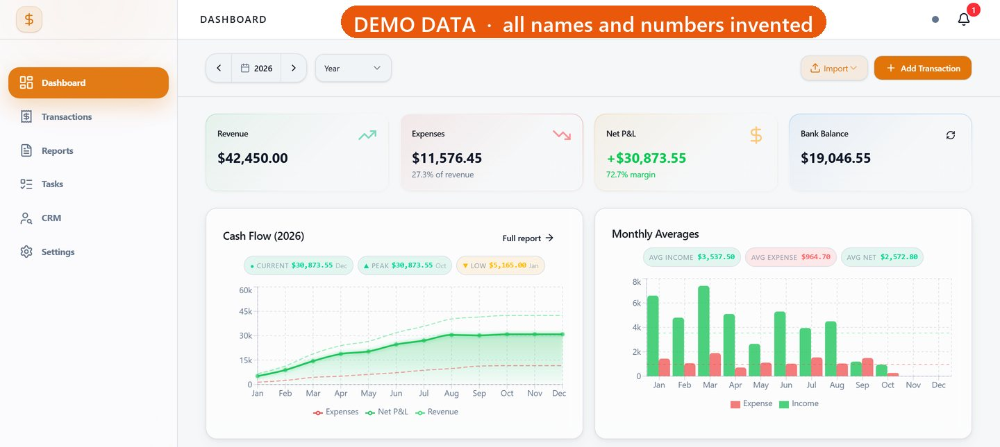
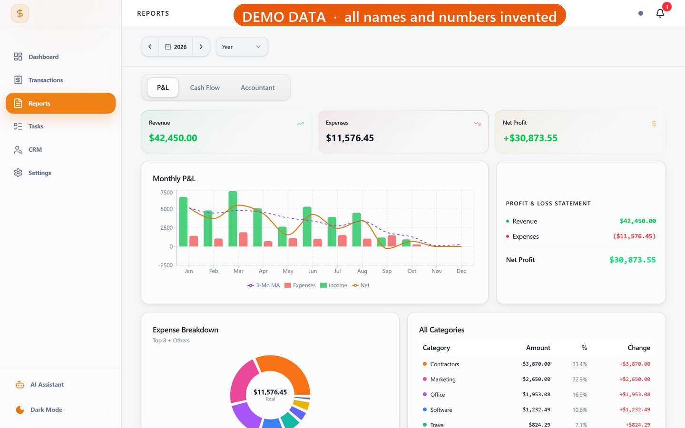
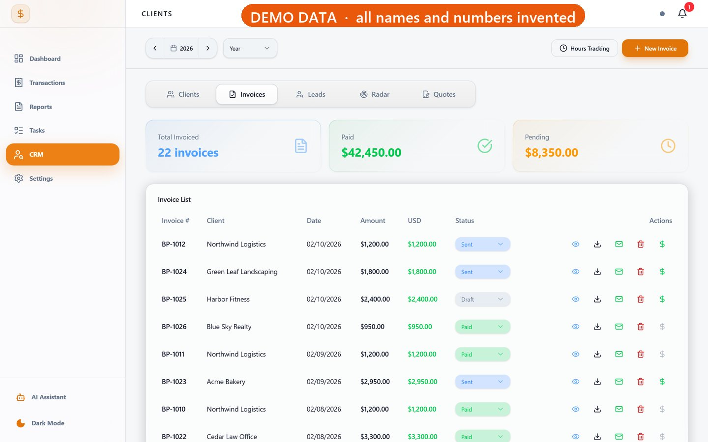
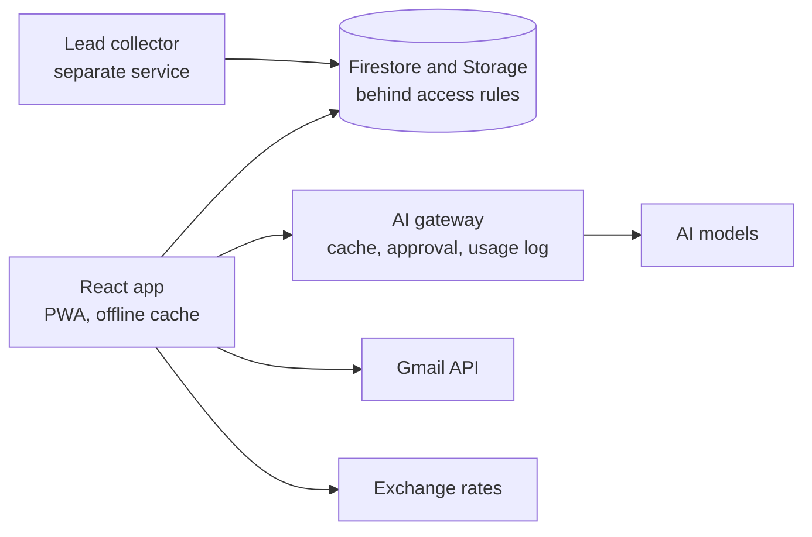

# Finance and CRM Platform

A web app that runs the money side of a small service business, from the first lead and the quote to invoices, expenses, reports and the year-end file for the accountant. React and TypeScript on Firebase, with AI for reading receipts and statements.

Solo project: first a desktop app, then the move to the web in 2026.

**All screenshots use a demo build with invented data.** The company, the clients and every number are made up.

**Highlights**

- Moved a desktop finance app from Electron and SQLite to React and Firestore, and switched over only after an automated reconciliation showed the old and new data matching.
- Sent every AI task through one gateway, with a cache, a paid fallback that runs only after the user approves it, and usage monitoring of tokens, cost and latency.
- Tested the database and file access rules in the local Firebase emulator with an automated suite of 1,157 access checks.

## Engineering notes

### A migration that had to prove itself first

The first version was a desktop app on Electron and SQLite. Moving years of books to Firestore was only safe if the new data told the same story as the old. Before the switch, an automated reconciliation compared the two, including profit and loss for every year to the cent and the balance of every account, and the cutover went ahead only when every hard check passed.

### One door for every AI task

Receipts, bank statements, lead translation and the assistant all go through one gateway. Repeated requests are served from a cache to cut repeated costs, a paid fallback runs only after the user approves it, and every attempt is logged with tokens, cost and latency. The gateway, the fallback and the log have 31 tests between them.

The schemas for the two AI providers are generated from one shared definition, to keep them from drifting apart.

### Access rules, tested

A script starts the Firebase emulator and runs reads, writes and deletes against the real database and file storage rules, as a signed-in stranger and as a signed-out visitor as well as the owner, and checks that every access that should be refused is refused. The suite has grown with the app to 1,157 access checks as of 6 October 2026.

  
  

## How it is checked

- **2,529 Vitest tests** in 123 files, on rules, services, the AI gateway and PDF output.
- **1,157 access checks** in the Firebase emulator.

Both passing on 6 October 2026.

## Architecture

Interactive finance and CRM workflows in the browser, with a separate service that collects leads into the same database.

## Stack

React 19, TypeScript, Vite, Tailwind CSS, Recharts, Firebase (Firestore, Auth, Storage, Hosting), PWA, Vitest, Anthropic API, OpenAI API, Gmail API.

## Source code

The code lives in a private repository. A private code review is available to hiring teams by arrangement.

Meir Mizrahi, [offart.space](https://offart.space), meir@offart.space
